# Honcho Tools

**Independent components for a self-hosted [Honcho](https://github.com/plastic-labs/honcho) 3.5.0 server, set from one file.**

Tools for importing large conversation histories into Honcho while controlling when dreams run and what they cost: a
dream scheduler with its dream hook, a telemetry receiver and nightly database dump, a dashboard, a model bridge
(subscription accounts, OpenAI-compatible APIs, or the Anthropic API), and an experimental reranker for memory
searches. Nothing forks Honcho; the dream hook and the reranker are loaded at start-up from Honcho's entrypoints, and one optional
source patch is kept separate.

[](LICENSE)

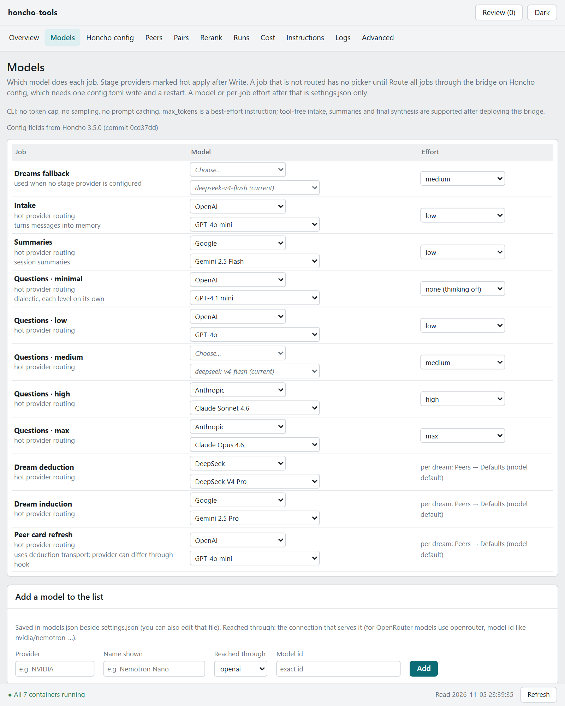

*The dashboard's Models page: which model and effort each Honcho job uses through the bridge. (Demo data.)*

> Unofficial community tool, not affiliated with Plastic Labs / [Honcho](https://github.com/plastic-labs/honcho).

## Why

I installed Honcho to ingest about a year of conversations I'd accumulated across several harnesses and many peers,
and realised Honcho dreams over new data so slowly that the backlog would have taken years to process. I started with
simple scheduling scripts to sequence dreams across the data dump. A dream is many long model calls, and Honcho starts
one on its own triggers (idle time, enough new conclusions). I made plenty of mistakes learning how to import
sensibly, and ended up repeating days of non-stop dreaming, paying for it each time. That was supposed to be the whole
project: a scheduler that runs dreams when you choose, on the model and provider you choose. I didn't want to modify Honcho's source, so
the scheduler works through a dream hook loaded from Honcho's entrypoint.

Running that at scale, and wiping the full database several times to start over and rerun everything, wasn't free.
Along the way I kept adding pieces that I felt mattered and that helped me understand Honcho better: a receiver for
Honcho's telemetry and a nightly database dump, to see what each run did and cost and to start over cleanly; a
dashboard, so none of this needs hand-edited JSON; and, after spending too much, a bridge that connects subscription
accounts (Codex, Claude Code), OpenAI-compatible APIs (DeepSeek, OpenRouter, GLM, ...) or the Anthropic API.

Last came a reranker. Honcho ranks conclusions by embedding distance, and I wanted to see whether that could be
improved, so I benchmarked it offline first (`bench/`), then built it.

None of this forks Honcho. The dream hook and the reranker change Honcho's behaviour at runtime, loaded at start-up
from its entrypoints, and the one optional source patch is kept separate.

## Requirements

- Docker with Compose v2 on the host that runs Honcho 3.5.0, and Honcho's compose network.
- For the backends: the API keys of the providers you use, in Honcho's `.env`, or the Codex and Claude Code CLI
  logins (the CLIs are installed into the bridge image only when asked for at build).
- For the reranker (optional): a Voyage, Cohere or Jina key, or a TEI server of your own.
- For the tests and `src/config/validate.py`: Python 3 and `pip install -r requirements-dev.txt`.

**Tested only on one Linux Docker host with Honcho 3.5.0; the offline tests on Windows 10 with Python 3.14.**
Other setups are untested.

## Quick start

1. On the Docker host, clone the repository beside Honcho's project folder and run the setup script:

   ```bash
   git clone <repository-url> honcho-tools      # next to the folder that holds Honcho's compose file
   cd honcho-tools
   sudo ./setup.sh                              # or: sudo ./setup.sh /path/to/honcho
   ```

   It writes `deploy/.env` and `config/settings.json` from the examples, gives the logs and CLI-login folders to
   the containers' user and prints the lines for step 4 with your paths filled in. It never touches Honcho's
   files. Then set `HONCHO_WORKSPACE` in `deploy/.env`. The same steps by hand, or with other paths:
   [docs/SETUP.md](docs/SETUP.md).
2. Put the secrets in Honcho's own `.env` (`${HONCHO_ROOT}/.env`): at least `TELEMETRY_TOKEN`, and the provider keys
   your backends name. `deploy/.env.example` lists every name the stack reads from there.
3. Start the stack: `docker compose -f deploy/compose.yaml up -d --build`.
4. Add the lines `setup.sh` printed (from `deploy/honcho-mounts.yaml`) to Honcho's `api` and `deriver` services
   yourself, point Honcho's `TELEMETRY_ENDPOINT` at the receiver (`src/telemetry/README.md`), and recreate `api`
   and `deriver`. This is the one change to Honcho's compose file.
5. Open the dashboard on port 8010. Set `CONTROL_PASSWORD` in Honcho's `.env` first if anyone else can reach it.
6. To send Honcho's model calls through the bridge, use **Route all jobs through the bridge** on the dashboard's
   **Honcho config** page, Write, and restart Honcho once. Each job's previous model becomes its Honcho-native
   fallback. After that, every model and effort choice on the **Models** page is hot and writes only `settings.json`.

`settings.example.json` starts in `stock` mode with reranking off, no peers or pairs, defaults on Honcho's shipped
values (brief 50, 12 and 10 rounds), and Route all keeps every job on the model it has (on a stock Honcho, OpenAI
`gpt-5.4-mini`), so Honcho behaves as before, before and after routing, until a setting is changed. `src/rerank/patches/summary-output-headroom.patch` is the one change to Honcho's source; it adds the
`[summary] output_headroom` setting and is applied by hand before Honcho's image is built (`src/rerank/patches/`).

## How it works

| Component | Folder | Runs as | Needs | If it is stopped |
|---|---|---|---|---|
| Bridge | `src/bridge/` | service `bridge`, on Honcho's network only (`http://bridge:8793/v1`) | `settings.json` (starts without it); a provider key in Honcho's `.env` per API backend; the CLI logins in `SECRETS_DIR` for CLI backends | A Honcho call that points at it fails after Honcho's retries, unless that job has a Honcho-native `fallback` in `config.toml`, which the final retry attempt then uses. Nothing in this stack depends on it. |
| Scheduler | `src/scheduler/` | service `scheduler` | Honcho's database (read) and API (`HONCHO_API_TOKEN`, `HONCHO_WORKSPACE`); starts without either | In `scheduler` mode no dream is queued and new peers and pairs are not discovered; in `stock` mode nothing changes. |
| Dream hook | `src/hooks/` | inside Honcho's deriver, from the reranker's deriver entrypoint, or `python /app/policies/deriver_main.py` when rerank is not installed | `settings.json` read-only; the rerank package only when reranking is installed | Not a service. Without an entrypoint line the deriver is stock Honcho. |
| Telemetry receiver | `src/telemetry/` | service `telemetry` (port 8765 on Honcho's network, not published) | `TELEMETRY_TOKEN`; Honcho's `TELEMETRY_ENDPOINT` pointed at it | Honcho buffers events in memory and sends them when it is back; past the buffer the oldest are dropped. Honcho's calls do not fail. |
| Backup | `src/backup/` | service `backup` (`pgvector/pgvector:pg15`, the database's own image) | `POSTGRES_PASSWORD` | No nightly dump. Nothing else uses it. |
| Dashboard | `src/dashboard/` | service `dashboard`, port 8010, plus two Docker socket proxies for restarts | `settings.json`, Honcho's `config.toml`, `HONCHO_API_TOKEN`; each page says what it is missing | No page and no restart buttons. Everything else keeps reading `settings.json`. |
| Rerank | `src/rerank/` | inside Honcho's api and deriver, from their entrypoints | `RERANK_API_KEY` for a hosted reranker; off by default | Off in `settings.json` means Honcho's searches are its own, unchanged. Any failure keeps the vector order. |
| Benchmark | `bench/` | scripts, not deployed | Python only for the offline demo; a database copy, telemetry and provider keys for a real run | Not part of the running stack. |

Each service starts alone: none has `depends_on`, and the bridge, the scheduler and the dashboard start without
`settings.json` and without each other (`tests/test_stack_layout.py` checks it). The hook and the reranker are not
services: they run inside Honcho's own processes. If either cannot install at start, Honcho still starts: the
reranker's entrypoints continue into stock Honcho without the wrapper, and a hook that fails keeps intake running and
blocks dreams unless `settings.json` is readable and lets Honcho dream on its own (`src/hooks/README.md`).

## Dashboard

Every page, with fictional demo data. Click one for full size.

<table>
<tr>
<td width="50%" valign="top"><a href="docs/images/overview-light.png">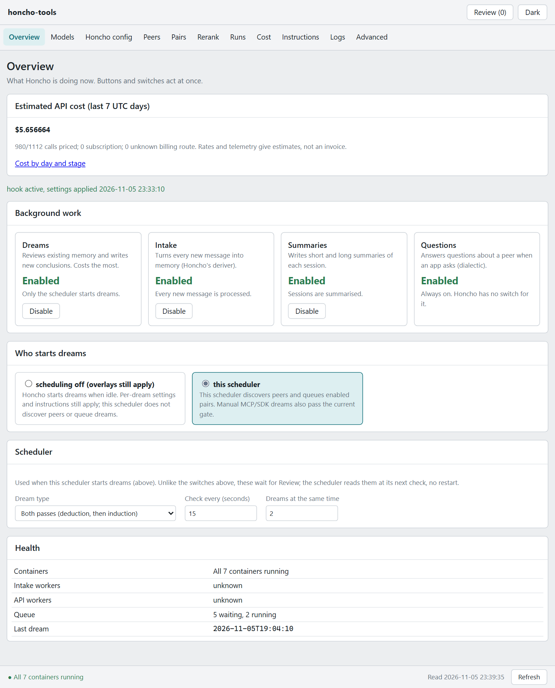</a><br><b>Overview</b>: cost, background work, who starts dreams, health</td>
<td width="50%" valign="top"><a href="docs/images/models-light.png"></a><br><b>Models</b>: model and effort per Honcho job</td>
</tr>
<tr>
<td width="50%" valign="top"><a href="docs/images/honcho-light.png">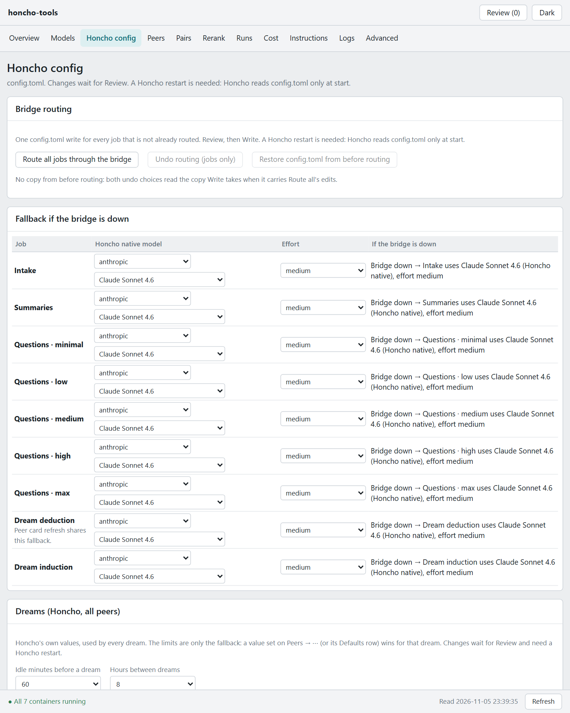</a><br><b>Honcho config</b>: routing, native fallbacks, dream knobs</td>
<td width="50%" valign="top"><a href="docs/images/peers-light.png">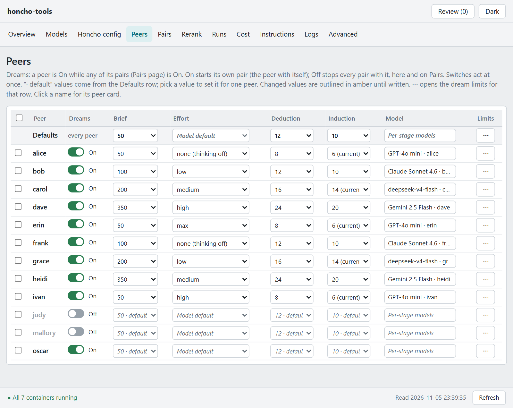</a><br><b>Peers</b>: dreams on or off and settings per peer</td>
</tr>
<tr>
<td width="50%" valign="top"><a href="docs/images/pairs-light.png">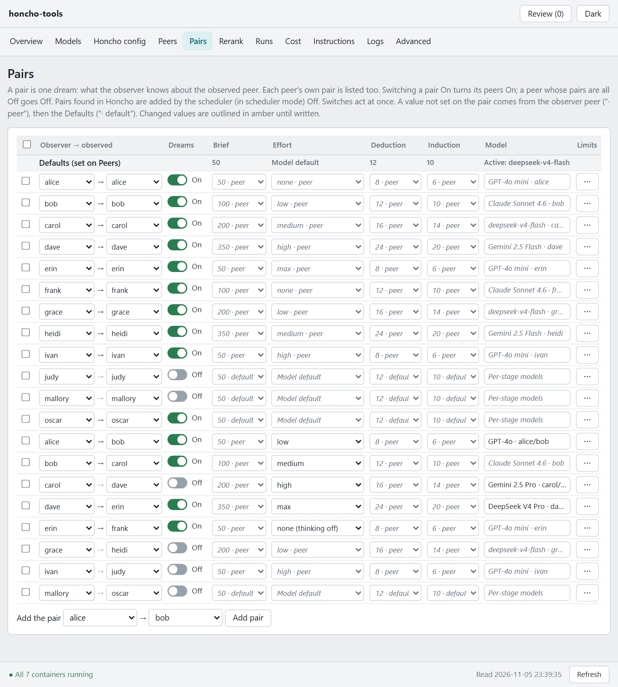</a><br><b>Pairs</b>: own pairs first, then cross pairs</td>
<td width="50%" valign="top"><a href="docs/images/rerank-light.png">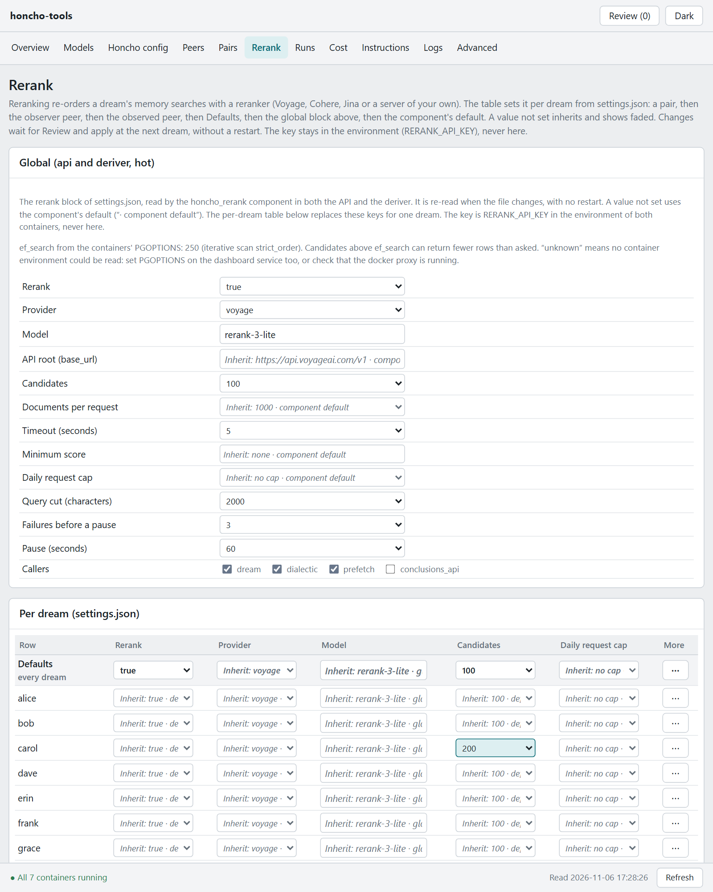</a><br><b>Rerank</b>: provider, model and recent searches</td>
</tr>
<tr>
<td width="50%" valign="top"><a href="docs/images/runs-light.png">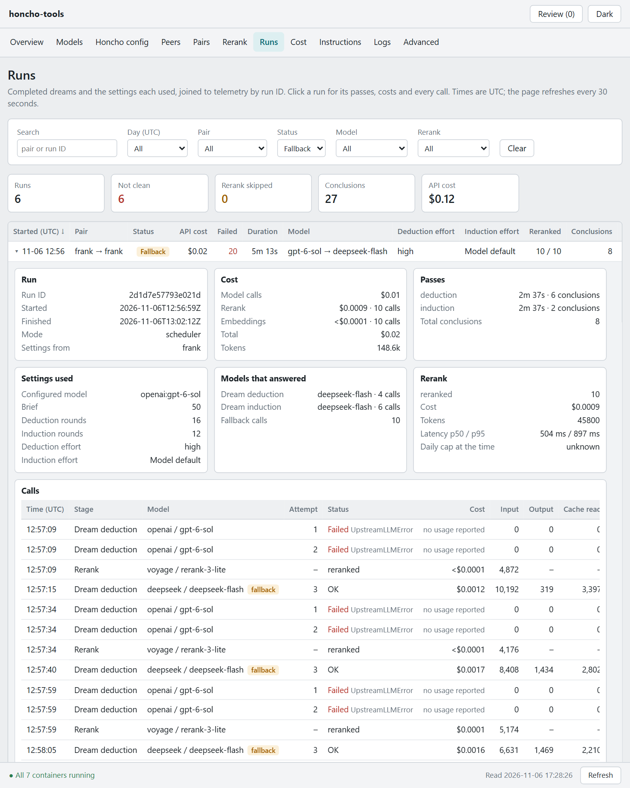</a><br><b>Runs</b>: every dream: who, model, time, cost, down to each call</td>
<td width="50%" valign="top"><a href="docs/images/cost-light.png">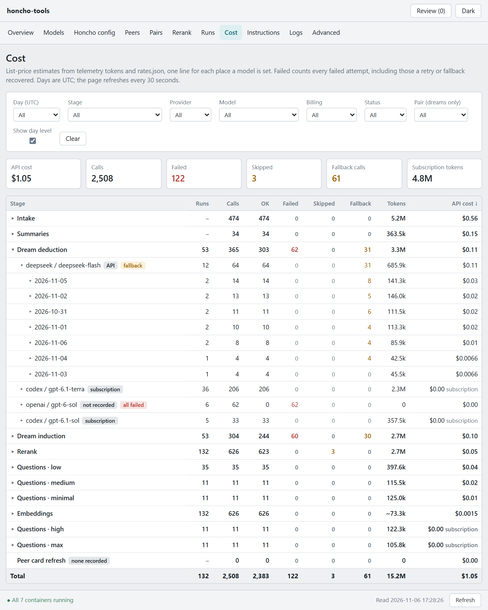</a><br><b>Cost</b>: estimated cost per job, by provider, day and run</td>
</tr>
<tr>
<td width="50%" valign="top"><a href="docs/images/instructions-light.png">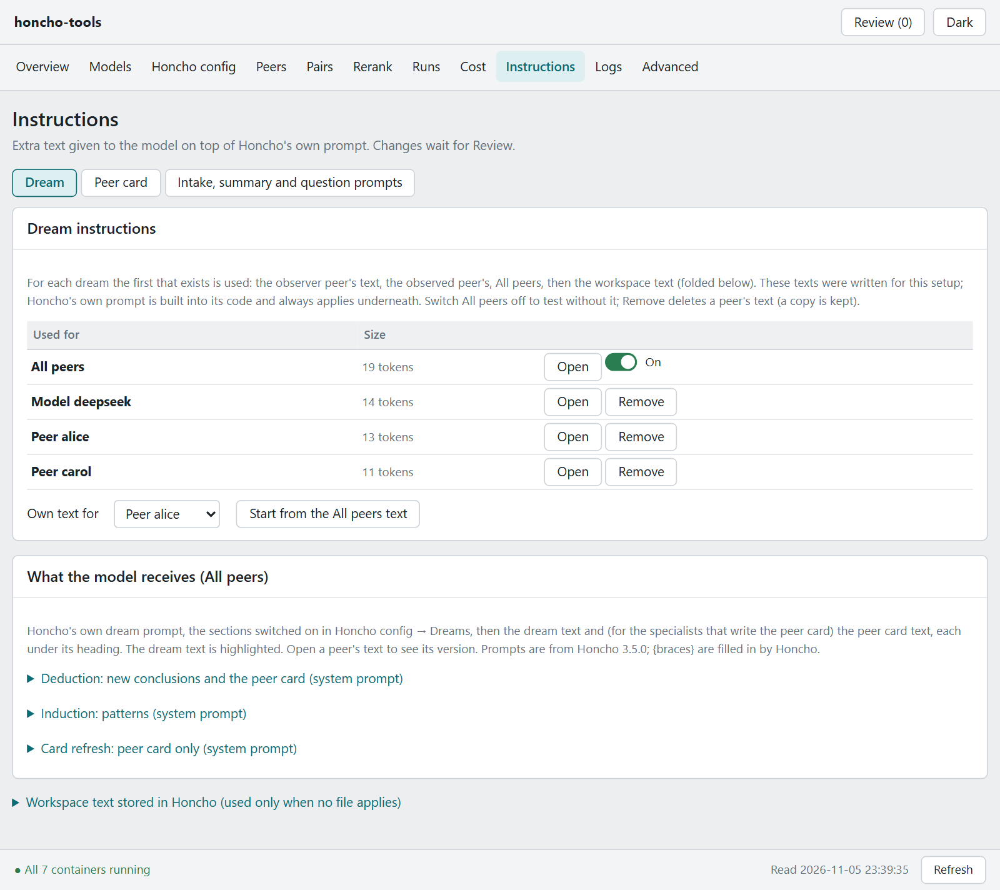</a><br><b>Instructions</b>: default, backend and peer instructions</td>
<td width="50%" valign="top"><a href="docs/images/logs-light.png">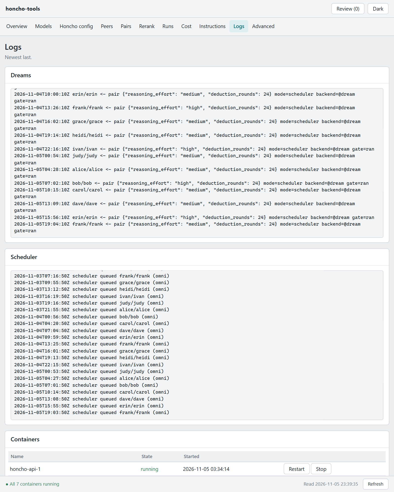</a><br><b>Logs</b>: every component's log and the containers</td>
</tr>
<tr>
<td width="50%" valign="top"><a href="docs/images/advanced-light.png">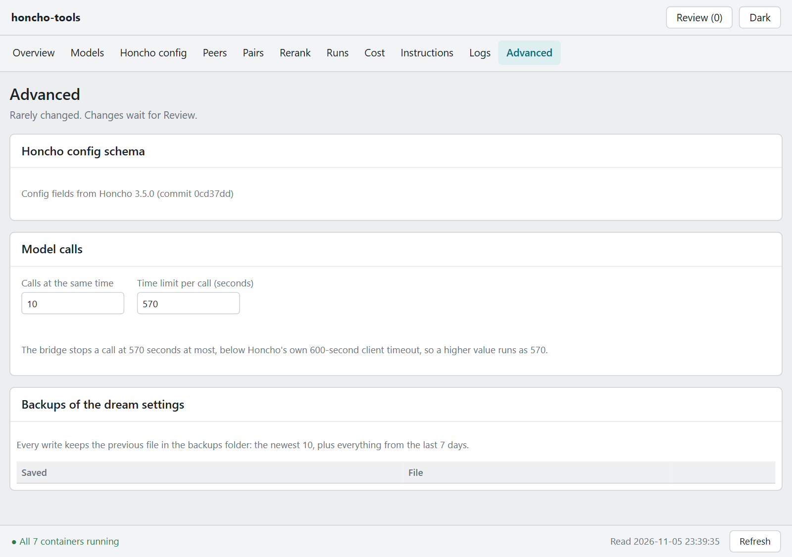</a><br><b>Advanced</b>: remaining settings, backups and restore</td>
<td width="50%"></td>
</tr>
</table>

## Configuration

- **Behaviour** lives in `settings.json` in `CONFIG_DIR`: mode (`stock` Honcho dreaming or `scheduler`), bridge
  backends and models, per-peer and per-pair dream settings, the schedule, log rotation and the rerank block. It is
  validated against `src/config/settings.schema.json`, written by the dashboard with a backup and a read-back, and
  re-read by every component when it changes, so day-to-day changes need no restart. `python src/config/validate.py`
  checks a file by hand. Every key is described in [docs/SETTINGS.md](docs/SETTINGS.md).
- **Secrets** live in two files that compose loads into every service on the host side: Honcho's `.env` (Honcho's
  own secrets and the provider keys) and `cli-secrets/tokens.env` (the stack's tokens, written once by `setup.sh`).
  `settings.json` names the environment variable that holds a key (a name ending in `_KEY`), never the key, and the
  schema refuses key-shaped text. `deploy/.env` holds paths, ports and names only.
- **Paths** are variables in `deploy/.env`: six live folders (`CONFIG_DIR`, `DATA_DIR`, `LOGS_DIR`,
  `TELEMETRY_DIR`, `BACKUP_DIR` and `SECRETS_DIR`, `tokens.env` and the bridge's CLI logins, sensitive), shipped empty beside `src/`
  with their contents ignored by git, plus `HONCHO_ROOT` (only its `.env` and `config.toml` are used). Nothing in the code assumes a
  host, a share or a user.
- **Honcho's `config.toml`** is edited from one place, the dashboard's Honcho config page: routing, the per-job
  Honcho-native fallback, the dream knobs and the summary headroom ([docs/HONCHO-CONFIG.md](docs/HONCHO-CONFIG.md)).

## What it changes on your system

- **Honcho's compose file**, once, by hand: two entrypoints, a few mounts and environment lines
  (`deploy/honcho-mounts.yaml`).
- **Honcho's source**, only if you apply the summary headroom patch.
- **Honcho's `config.toml`**, only when you write it from the dashboard. A copy goes to `config/backups/config-toml/`
  first, and a failed write puts that copy back.
- **Honcho's database**: the scheduler reads it and queues dreams through Honcho's API; the backup reads it with
  `pg_dump`. A restore (`src/backup/restore.md`) writes a scratch database only when run by hand.
- **Containers**: the dashboard can restart, start and stop the containers named in `RESTART_ALLOWED`
  (`src/dashboard/app/app.py`) through a socket proxy that allows those actions only.

## Where it keeps its data

Every folder is a variable in `deploy/.env`; the defaults are the folders shipped beside `src/`, whose contents git
ignores.

| Folder (variable) | Holds | Sensitive |
|---|---|---|
| `CONFIG_DIR` | `settings.json`, `models.json`, `rates.json`, and `backups/` (a copy before every save, `config.toml` copies included) | No keys; names of your peers and backends |
| `DATA_DIR` | `instructions/`, the dream and peer-card instruction texts | Your own texts |
| `LOGS_DIR` | every log of the stack, the hook's status file and run records, the bridge call log | Peer names, models, token counts |
| `TELEMETRY_DIR` | Honcho's telemetry events, one file per UTC day | **Yes** when Honcho sends trace payloads: real content |
| `BACKUP_DIR` | the nightly database dumps | **Yes**: all of Honcho's memory |
| `SECRETS_DIR` (`cli-secrets/`) | `tokens.env` (`BRIDGE_TOKEN`, `TELEMETRY_TOKEN`) and the Codex and Claude Code CLI logins | **Yes**: tokens in plain text |

Secrets themselves stay in Honcho's own `.env`; nothing in this stack writes them.

## Upgrading Honcho

1. Re-apply the patch to the new source tree if you use it (`src/rerank/patches/apply.sh` checks first), and rebuild.
2. Keep the lines from `deploy/honcho-mounts.yaml` on `api` and `deriver`.
3. Regenerate `src/config/honcho-config.schema.json` (`docs/HONCHO-CONFIG.md`, "Regenerate after a Honcho upgrade")
   and `src/config/honcho-prompts.json` (`python src/config/gen_honcho_prompts.py <Honcho src folder>`).

The hook and the reranker check Honcho's names and signatures at start. When they differ, the reranker's entrypoints
log the miss and run stock Honcho without the wrapper, and the hook's entrypoint keeps intake running (dreams are
blocked when `settings.json` is unreadable, `mode` is `scheduler`, or a peer or pair is disabled). The dashboard's Overview shows the hook state.
Check the Rerank and Overview pages after an upgrade.

## Documentation

| Read | For |
|---|---|
| [docs/SETUP.md](docs/SETUP.md) | Installing on a fresh host, step by step, with the checks after each step. |
| [docs/ARCHITECTURE.md](docs/ARCHITECTURE.md) | How the pieces fit together, the rules each component follows, what each may touch. |
| [docs/SETTINGS.md](docs/SETTINGS.md) | Every key of `settings.json`. |
| [docs/OPERATIONS.md](docs/OPERATIONS.md) | Day-to-day use: modes, routing, models and effort, peers and pairs, logs, backups, restarts, upgrades. |
| [docs/TROUBLESHOOTING.md](docs/TROUBLESHOOTING.md) | Symptoms, where to look, what to do. |
| [docs/INTERFACES.md](docs/INTERFACES.md) | The HTTP endpoints, files and log formats each component exposes. |
| [docs/HONCHO-CONFIG.md](docs/HONCHO-CONFIG.md), [docs/STAGE-ROUTING.md](docs/STAGE-ROUTING.md), [docs/EXECUTED-ROUTING.md](docs/EXECUTED-ROUTING.md) | The `config.toml` page, stage routing through the bridge, and the routing evidence in telemetry. |
| `deploy/README.md` | The compose stack: folders, what each container sees, the Docker socket, stopping one service. |
| `src/<component>/README.md` | Each component in depth: bridge, hooks, scheduler, telemetry, backup, dashboard, rerank, config templates. |
| [tests/README.md](tests/README.md) | What each test suite covers and how to run the ones that need Honcho. |
| [bench/README.md](bench/README.md) | The rerank benchmark: method, harness, results, offline demo. |

## Benchmark

Before turning the reranker on I measured it on that deployment's own searches. On 80 frozen real searches with every
candidate judged, strict precision at the caller's `top_k` rose from 69.58% to 78.97% with Voyage rerank-3-lite at a
pool of 100 (+9.39 points, 95% interval +5.40 to +11.93), at about +519 ms median latency and 0.096 USD per 1,000
searches in reranker tokens. A pool of 400 added +0.69 points over 100 (interval -1.20 to +1.98). Separately, the
vector index at Honcho's default `ef_search` of 40 without iterative scan returned 90.1% of the exact nearest
conclusions; with iterative scan at 250 it returned 99.6%. The relevance labels come from language models, the data
from one deployment, and the decision rule reads the result as inconclusive for production use. The method, the
harness, a synthetic dataset that runs offline and every table are in [bench/README.md](bench/README.md).

## Tests

```bash
pip install -r requirements-dev.txt
python -m pytest                          # offline: tests/ and bench/tests, about 80 seconds
```

The reranker's own tests need Honcho's Python environment (`src/rerank/README.md`), and `tests/e2e/` needs a Honcho
tree and Playwright. `tests/README.md` lists what each suite covers.

## Known limitations

- **Version 0.1.1, one deployment.** The stack has run on one Docker host with Honcho 3.5.0 since 2026-10-30, with
  live dreams, and with rerank calls to Voyage since 2026-11-03. Other setups are untested.
- **One workspace per stack.** The scheduler and the dashboard's peer pages work on `HONCHO_WORKSPACE`, and
  `settings.json` names peers without their workspace. In `scheduler` mode the hook holds every dream the
  scheduler did not start, so dreams in other workspaces do not run; keep `stock` mode if you use several.
- **Bound to Honcho 3.5.0.** The hook and the reranker depend on Honcho's module and function names.
- **Tested against fakes.** `python -m pytest` runs offline: no Honcho, database or provider. The bridge's backend
  kinds are tested against local HTTP and CLI stubs, the backup script against fake PostgreSQL tools.
  The reranker has met only Voyage live; Cohere, Jina and TEI are tested against fakes. `tests/e2e/` drives the
  dashboard, Honcho 3.5.0's own settings and LLM code, the hook and the bridge end to end, also against fake
  providers; it needs a Honcho tree, Playwright and Chromium, and skips without them.
- **The dashboard login is optional HTTP basic over plain HTTP.** Without `CONTROL_PASSWORD` the page is open. Keep
  port 8010 on a trusted network (`BIND_IP`) or behind a TLS proxy. Whoever reaches the dashboard can, through it,
  reach what the read-only socket proxy allows (`deploy/README.md`, "The Docker socket").
- **Every container except the two socket proxies receives Honcho's whole `.env`** through `env_file`; telemetry, backup and the scheduler drop what
  they do not read at start, the dashboard and the bridge keep it. `deploy/README.md` explains why.
- **Cost figures are list-price estimates** from sampled telemetry, never invoices (`docs/EXECUTED-ROUTING.md`).

## Contributing and license

The version lives in `VERSION`; every functional change bumps the patch and adds a line to the
[changelog](CHANGELOG.md). [CONTRIBUTING.md](CONTRIBUTING.md) has the rules and the branch model.

Released under the [GNU Affero General Public License v3.0](LICENSE), the licence of Honcho itself. Some files are
derived from Honcho (its prompts, its settings schema, the patch); [THIRD_PARTY_NOTICES.md](THIRD_PARTY_NOTICES.md)
lists them and credits the community work the reranker builds on.
