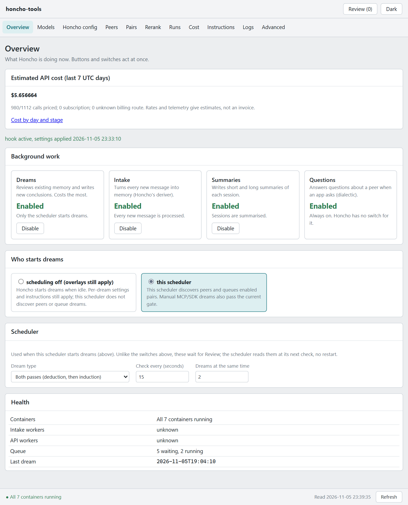
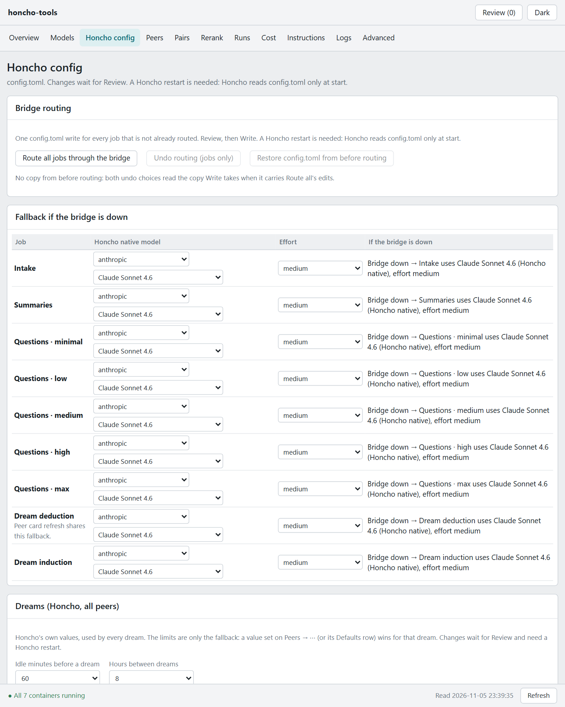
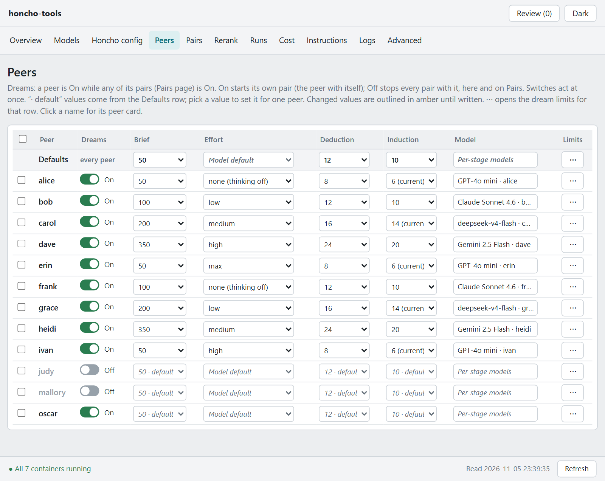
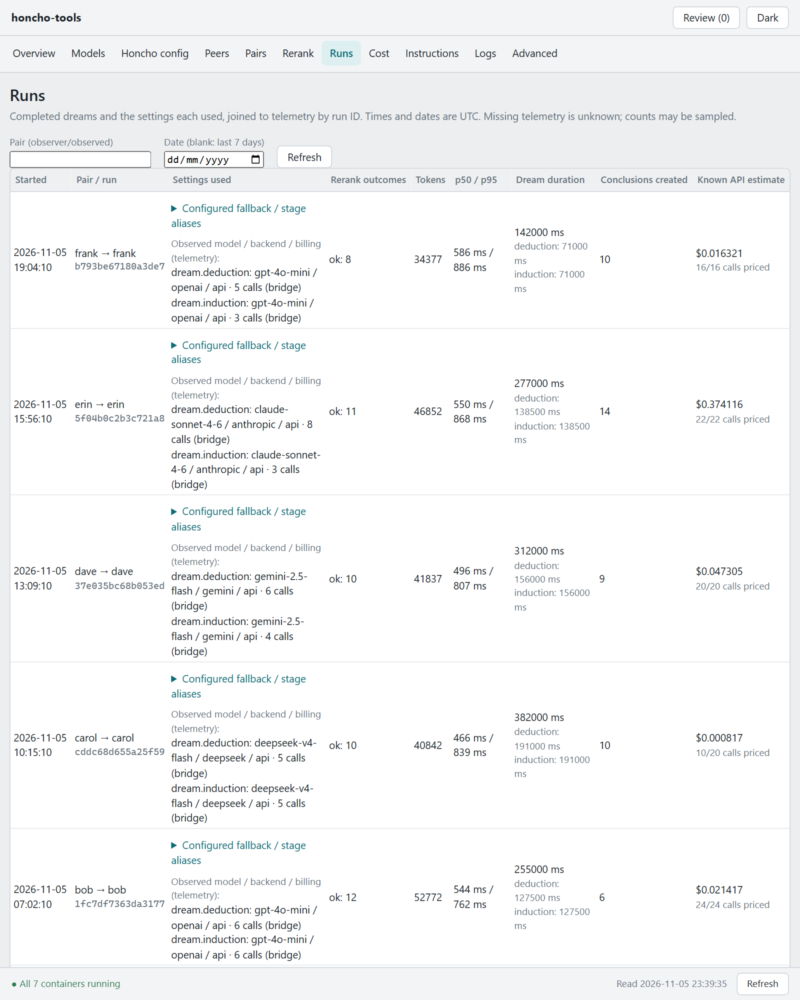

# dashboard

Web dashboard that edits `settings.json`, the instruction files, and Honcho's `config.toml`. One process, one HTML page, no build step for the page. With `CONTROL_PASSWORD` set, every route needs an HTTP basic login (`CONTROL_USER`, default `admin`); blank or unset, the page is open. Every write must be `application/json`, so a page on another site cannot post to it. Nothing is deployed from here.

## Which image to build

Build the Dockerfile once. It installs `requirements.txt` (`fastapi`, `uvicorn`, `jsonschema`, `tomlkit`, and what they pull in) into `python:3.12-slim`, then runs `uvicorn app:app --host 0.0.0.0 --port 8010`. `deploy/compose.yaml` uses that image (`honcho-tools-dashboard:local`, container `honcho-tools-dashboard-1`). A restart does not install packages and does not need a network.

Tested with Python 3.12.16, fastapi 0.136.1, uvicorn 0.46.0, jsonschema 4.26.0 and tomlkit 0.15.2.

The other form is a stock image that installs on every start. Replace the `build` / `image` keys of the `dashboard` service with:

```yaml
image: python:3.12-slim
working_dir: /app
command: ["sh", "-c", "pip install -q fastapi uvicorn jsonschema tomlkit && uvicorn app:app --host 0.0.0.0 --port 8010"]
```

Keep the same volumes, port, environment and network. That command matches a cold start with no Dockerfile. It needs a network every time the container starts, and it repeats the install. Use the Dockerfile.

The page calls Honcho with the standard library. `httpx` is not installed in the image.

## Build and start

The compose project is `deploy/`. Paths come from `deploy/.env` (copy `deploy/.env.example`).

1. Set `CONTROL_PASSWORD` in Honcho's `.env` to require a login; leave it blank for an open page (testing, or a port only you can reach). The login is plain HTTP basic: keep the port on a trusted network or behind a TLS proxy.
2. Set `HONCHO_ROOT` to Honcho's compose folder. Its `.env` is loaded through `env_file`, and its `config.toml` is bound as one file at `/honcho/config.toml`. Nothing else from that folder is mounted.
3. Leave `CONFIG_DIR` (`settings.json`, `models.json`, `rates.json`, `backups/`), `DATA_DIR` (instruction files) and `LOGS_DIR` (logs) at their defaults or point them elsewhere. The service mounts `CONFIG_DIR` at `/config` and reads `/config/settings.json` and `/config/models.json`. Copy `src/config/settings.example.json` to `settings.json` there if the file does not exist yet; until then the page shows the example's defaults and logs one line. Compose sets `CONTROL_FILE` to `/config/settings.json`. Do not set `CONTROL_FILE` to a host path.
4. Set `BIND_IP` to the address the port is published on. Empty publishes on every interface (`0.0.0.0`). The port is 8010.
5. Set `HONCHO_API_URL` (default `http://api:8000`), `HONCHO_API_TOKEN`, `HONCHO_WORKSPACE` and `TELEMETRY_DIR`. The token and the password stay in Honcho's `.env`.
6. Build once and start: from a shell in `deploy/`, `docker compose up -d --build dashboard` (or open `deploy/` as a project in your Docker UI).
7. The service joins the external network `${HONCHO_NETWORK}` (default `honcho_default`), the same network as the scheduler. It also joins the internal network `restart`, which is the only network `docker-proxy` is on.

Volumes:

| Host | Container | Use |
|---|---|---|
| `src/dashboard/app` | `/app` (read-only) | `app.py`, `backups.py`, `honcho_config.py`, `index.html` |
| `src/config` | `/templates` (read-only) | `settings.schema.json`, `settings.example.json`, `honcho-config.schema.json`, `honcho-prompts.json`, `models.json` (seed) |
| `${CONFIG_DIR}` | `/config` (read-write) | `settings.json`, `models.json`, `rates.json`, `backups/` |
| `${HONCHO_ROOT}/config.toml` | `/honcho/config.toml` (read-write, one file) | Honcho's `config.toml` (rewritten in place) |
| `${DATA_DIR}` | `/data` (read-write) | `instructions/` |
| `${LOGS_DIR}` | `/logs` (read-write) | `policy-used.log`, `runs.log` and `hook-status.json` (written by the deriver hook), `dream-nas.log` (scheduler), `restart.log` (this service) |
| `${TELEMETRY_DIR}` | `/telemetry` (read-only) | `events-YYYY-MM-DD.jsonl` |

| Variable | Default | Meaning |
|---|---|---|
| `CONTROL_FILE` | `/config/settings.json` | The settings file. `models.json`, `rates.json` and `backups/` sit beside it. |
| `HONCHO_CONFIG_FILE` | `/honcho/config.toml` | Honcho's config file. See `docs/HONCHO-CONFIG.md`. |
| `DATA_DIR` | `/data` | `instructions/`. Compose sets it, because `env_file` also passes in the host path. |
| `INSTRUCTIONS_DIR` | `${DATA_DIR}/instructions` | The instruction files. |
| `HONCHO_CONFIG_BAK_DIR` | `backups/config-toml` beside `settings.json` | `config.toml` copies. |
| `POLICY_LOG`, `SCHEDULER_LOG`, `RESTART_LOG`, `POLICY_STATUS` | `/logs/policy-used.log`, `/logs/dream-nas.log`, `/logs/restart.log`, `/logs/hook-status.json` | Logs and the hook status. |
| `TELEMETRY_DIR` | `/telemetry` | Telemetry events. |
| `SCHEMA_FILE`, `EXAMPLE_FILE`, `HONCHO_SCHEMA_FILE` | files in `/templates` | Shipped schemas. |
| `DOCKER_PROXY_URL`, `DOCKER_PROXY_ACTION_URL` | unset | The two socket proxies. |

A single-file bind of `settings.json` does not follow a temp-file rename: the container keeps the old inode. The scheduler, this service, the deriver, the api and the bridge mount the config folder, so a dashboard save is the file they read on the next mtime check.

The service starts without `settings.json`, without the scheduler, the bridge, the docker proxies or the Honcho API: each section that needs one says what is missing and the rest of the page works. With `settings.json` present but unreadable, the pages that need it (Overview, Models, Peers, Pairs, Rerank, Instructions, Advanced) show the server's reason in one box; Honcho config, Runs, Cost and Logs draw from their own data.

## First login

Open `http://<BIND_IP>:8010`, and sign in when `CONTROL_PASSWORD` is set. A left menu holds the pages: Overview (who starts dreams, workspace switches, the scheduler, health), Models (the model and per-job effort of each job routed through the bridge, `settings.json` only), Honcho config (bridge routing with its two undo choices, the per-job Honcho-native fallback, dream knobs, the summary headroom, restart; the one page that writes `config.toml`, see `docs/HONCHO-CONFIG.md`), Peers, Pairs, Rerank, Runs, Cost, Instructions, Logs (dream and scheduler logs, containers) and Advanced (the Honcho config schema version, bridge call limits, backups of the settings). Below 1100 px the menu becomes a strip across the top. The top bar has Review (N) and the light/dark switch; the status bar at the bottom shows health, the last read time and Refresh. An open tab reloads by itself when `settings.json` changes. Runs, Cost and the rerank call summary show UTC; other times are the browser's local time.

| | |
|---|---|
|  |  |
| *Overview: background work, who starts dreams, health. (Demo data.)* | *Honcho config: routing and each job's Honcho-native fallback. (Demo data.)* |
|  |  |
| *Peers: dream settings per peer over the defaults. (Demo data.)* | *Runs: completed dreams with their calls, reranks and cost. (Demo data.)* |

Every field has a tooltip on its label or column header (name, description, allowed values; for Honcho fields the current source and the default). Empty peer and pair fields inherit the defaults. Picking a disabled backend as the dreams fallback turns it back on. A key is refused: the file may name `key_env`, and a string with a word that starts with `sk-`, `AIza`, `Bearer ` or `eyJ` is rejected and is not echoed (`task-runner` is not).

Peers come from the file, merged with `POST /v3/workspaces/<HONCHO_WORKSPACE>/peers/list` (the live route is POST, with `page` and `size`). A name that is only in the API can be added as `enabled: false`. Card preview calls `GET /v3/workspaces/<workspace>/peers/<id>/card`. Queue status calls `GET /v3/workspaces/<workspace>/queue/status`. If the workspace or the token is unset, those sections say so and the rest of the page still works.

## Saving

Who starts dreams, the workspace switches, the Dreams switches on Peers and Pairs and Add now (dreams off) act at once. Every other edit waits: Review (N) lists the pending changes with before and after and an Undo per change, and Discard drops them all. Write writes `settings.json`, the instruction files, the workspace configuration and `config.toml`, in that order. Leaving the page with pending changes asks first.

A file write is a temp file in the same directory, then rename, then a read-back compare (`config.toml` is written in place, and a write that fails after the file was opened puts the backup it took back before failing). The previous file is copied into `backups/` in `CONFIG_DIR`: `backups/settings/`, `backups/models/`, `backups/instructions/<relative path>/`, `backups/workspace/` and `backups/config-toml/`, as `<file>.bak_<YYYYMMDD_HHMMSS>`. The newest 10 copies per file are kept, plus any younger than 7 days. The first create has no backup. On start, older `*.bak-*` files beside the instruction files are moved there (never deleted). The scheduler writes its `settings.json.bak-*` copies straight into `backups/settings/`, and Advanced lists them with the dashboard's own. Advanced lists the settings copies; Restore writes one back at once. `GET /api/history` also returns the instruction, workspace and `config.toml` copies.

The token estimate is 4 characters per token, the fallback used when the deriver tokenizer is not imported. The cap is `MAX_CUSTOM_INSTRUCTIONS_TOKENS` (2000 unless `INSTRUCTION_TOKEN_CAP` is set lower). Over the cap, the file is still saved. The deriver applies it and writes a warning to `policy-used.log`. An empty file clears that category. A missing instructions folder is not an error.

## Instruction files

The files live in `instructions/` in `DATA_DIR`, mounted here at `/data/instructions` and into the deriver read-only at the same path. The deriver hook reads them on every dream. Nothing in this folder is written to the database, and `settings.json` has no field pointing here.

The tree, where `<backend>` is a key of `providers.backends` (the part before any `:model`) and `<peer>` is a peer name:

```
default/<kind>.md
backends/<backend>/<kind>.md
peers/<peer>/<kind>.md
```

`<kind>` is `dream`, `peer-card`, `reasoning`, `summary` or `dialectic`. The deriver hook reads only `dream` and `peer-card`: the observer's file, then the observed peer's file, then the backend file, then the default file, then the database value. An empty file clears that category, so empty default files are not shipped. `reasoning`, `summary` and `dialectic` are not read from here: Honcho takes those from the workspace configuration, and a file of that kind in this tree is only a note.

For one release a flat name at the top of the folder still applies when the new file is missing: `<backend>-dream-instructions.md`, `<backend>-peer-card-instructions.md`, `default-dream-instructions.md`, `default-peer-card-instructions.md`. The hook logs one deprecation line when it uses one. On start the dashboard moves that file into the tree when the new path does not exist. The bridge does not read these files.

Instructions has one box for dream and one for peer-card. Each lists the default file and only the backends or peers that have their own file; Add override stages a copy of the default for another backend or peer. The database (stock) text is collapsed. Copy from default and Create from backend fill the editor as a working edit. Nothing in these files is written to the database, and `settings.json` gains no field.

## Containers

The containers the dashboard may restart, stop or start are a constant in `app/app.py`, `RESTART_ALLOWED`: `honcho-api-1`, `honcho-deriver-1`, `honcho-tools-bridge-1`, `honcho-tools-scheduler-1`, `honcho-tools-telemetry-1`, `honcho-tools-backup-1` and `honcho-tools-dashboard-1`. A name is the first name `GET /containers/json` reports for that container, without a leading slash. Change the constant when a container name changes. Client filtering for the published port belongs in the host firewall.

Restart, Stop and Start send `POST /containers/<name>/<action>?t=10` to `DOCKER_PROXY_ACTION_URL` (the action-only proxy; listing uses `DOCKER_PROXY_URL`; compose sets `http://docker-proxy:2375`) with a 60 second timeout. The name must be in the list. A miss is 403 with a one-line reason. Each call is written to the process log and appended to `RESTART_LOG` (default `/logs/restart.log`, which is `${LOGS_DIR}/restart.log`). That file rotates once it grows past `logs.max_mb` (default 10) and keeps `logs.keep` previous copies (default 1).

Restart Honcho on the Honcho config page restarts the one name in the list that matches the compose service `api` and the one that matches `deriver` (the bare service name or `<project>-<service>-<n>`). If `DOCKER_PROXY_URL` is unset or the proxy cannot be reached, the Containers section shows that error and the rest of the page still works. A name in the list that the proxy does not know is shown as `unknown`.

## Flip mode and check the log

1. Read the Mode explanations. `stock` leaves Honcho's own dreaming in place. The scheduler stays up and sleeps.
2. Choose `scheduler`. Review the diff. Confirm.
3. On the host, read `${LOGS_DIR}/policy-used.log` (in this container, `/logs/policy-used.log`). The Logs page shows the newest lines.
4. A dream queued through the schedule route ends with `mode=scheduler` and `gate=ran`: the route's `trigger_reason` is `manual`, which the hook accepts when `scheduled_by` is absent. A dream Honcho started itself ends with `mode=scheduler gate=skipped-mode`.
5. Switch back to `stock` the same way. The next dream line ends with `mode=stock` and is not skipped for mode.

`dream-nas.log` is the scheduler log, in `LOGS_DIR`. Today's telemetry file is `events-YYYY-MM-DD.jsonl` under `TELEMETRY_DIR`. The status line shows its size and the `received_at` of the last event.

## Workspace switches and models in use

The Overview page switches dreams, intake (reasoning) and summaries in the Honcho workspace configuration (`dream.enabled`, `reasoning.enabled`, `summary.enabled`); Honcho reads them per request. "Not set" removes the key so Honcho's own setting applies. Dialectic cannot be paused from configuration. `[dream] ENABLED` from `config.toml` is shown read-only because it needs a restart.

The same page lists the model and transport each task resolves to from `config.toml` (deriver, summary, each dialectic level, dream deduction and induction, embedding). A task the file leaves without a model or a transport is shown in red as "Honcho default: <model>". While any such block exists, the Honcho config page shows a warning and Restart Honcho (the restart of api and deriver, `POST /api/honcho-config/apply`) is refused with 409. The embedding model is set once in config.toml at install; changing it later means re-embedding all stored memory, so the dashboard does not offer it.
